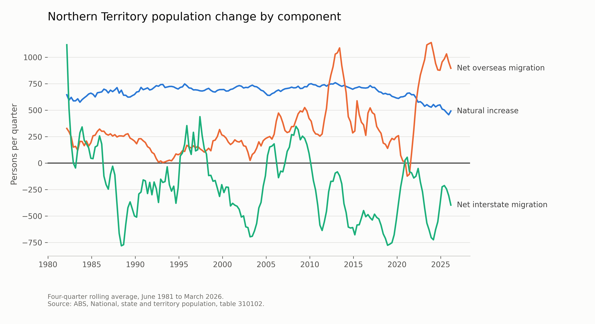
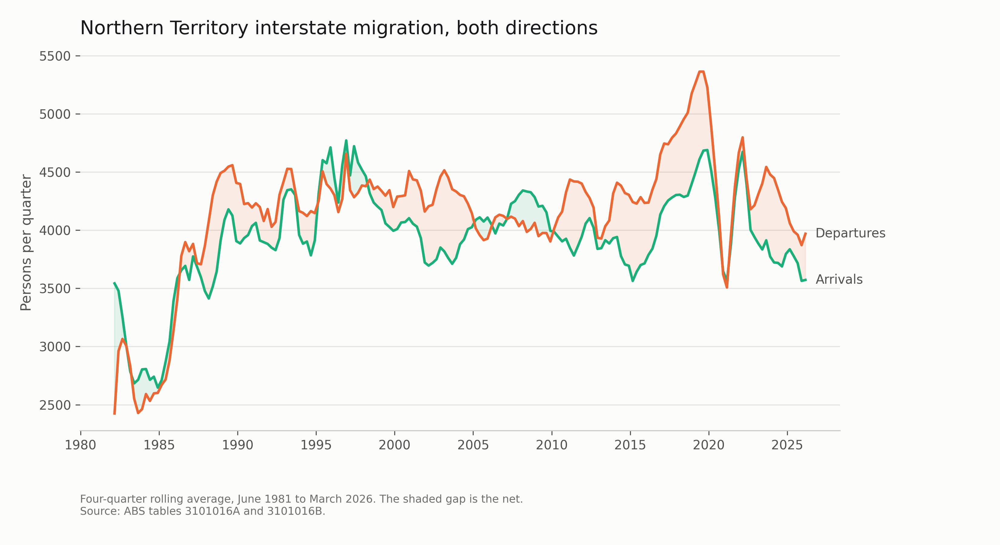
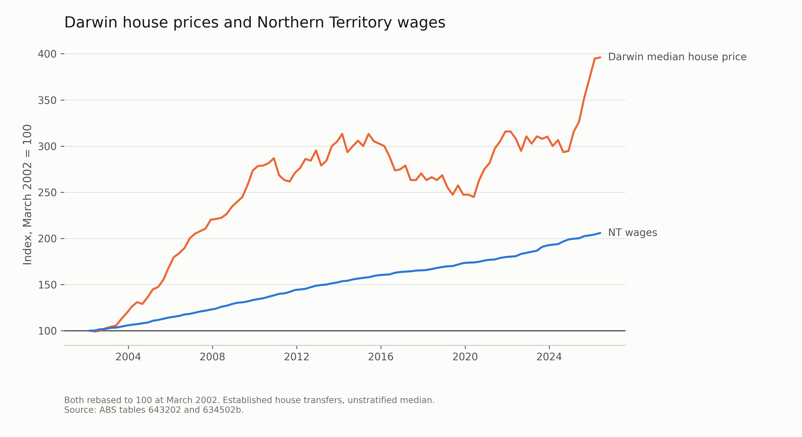

# The Territory's Population Equation

Where Northern Territory population growth comes from, and which component
makes forecasting it hardest.

**CDU IT Code Fair 2026** | Research Competition (RES003) and Poster
Competition (POS006)
Van Hoi (Hendrick) Dang, Ngoc Ngan Le, Phuong Vy Ho, Thi Kim Anh Bui

---

## The question

The Northern Territory plans schools, hospitals and housing from population
forecasts. A forecast is only as stable as the parts it is built from.

Population change has exactly three components:

```
change  =  natural increase  +  net interstate migration  +  net overseas migration
```

The NT is the only Australian jurisdiction that loses residents to other
states while still growing. This project asks which component makes up the
difference, how that has shifted, and which component carries the forecast
risk.

## Findings

ABS release of March 2026. Series: June 1981 to March 2026, 180 quarters.



**Net overseas migration accounted for 90.4% of the Territory's population
growth in the year to March 2026.** Natural increase added 1,969, interstate
migration subtracted 1,589, and overseas migration added 3,585, for total
growth of 3,965 on a population of 268,899.

**That reliance is rising**, not steady: 74.4% across the last ten years,
84.5% across five, 90.4% across twelve months.

**The interstate deficit is recent.** Net interstate migration was positive in
49% of quarters during the 1980s and 8% during the 2010s. It has been negative
for 18 consecutive quarters, since September 2021.

**Growth has shifted onto the least stable inputs.** Natural increase is the
only steady component, with a coefficient of variation of 0.13. Interstate
migration is 1.14 and overseas migration 0.96, roughly eight times more
variable. Forecast uncertainty is therefore concentrated in the migration
components, which a single headline growth rate does not reveal.

**The components reconcile exactly.** They sum to 3,965 against the 3,965 the
ABS publishes for the same period, a difference of zero. The headline figure
is arithmetic, not an estimate of ours.

## What this repository does

1. Reads ABS tables 310102 and 310104, quarterly, Northern Territory only.
2. Decomposes population change into the three components.
3. **Validates** that they reconcile against the published change in estimated
   resident population. If they do not, the pipeline stops and writes nothing,
   rather than reporting a number nobody checked.
4. Measures the volatility of each component across the full series.
5. Writes the headline figures, the cleaned series, the chart images and an
   interactive dashboard.

The analysis is a pipeline rather than a report. The ABS revises these tables
every quarter; re-running three commands against a newer download reproduces
every figure in the project.

The slide and the poster are laid out separately. This repository supplies the
numbers and the finished chart images that go into them.

[`SLIDE_BRIEF.md`](SLIDE_BRIEF.md) is the specification for the single
presentation slide: canvas size, exact text, which chart image to use, the
colour values, and what must stay off it. It is written to be followed in Canva
without reading any code.

## The data

Both ABS workbooks are committed, in `data/raw/`. Nothing needs downloading.

They are the exact files every figure here was computed from, the March 2026
release, 181 KB together. The ABS republishes each quarter at the same
`latest-release` URL and replaces what was there before, so a reader who
downloads from that link next year gets a different release and different
numbers. Pinning the snapshot is what lets a clone reproduce the figures on the
poster rather than merely reproduce the method.

[`data/raw/SOURCE.md`](data/raw/SOURCE.md) records the release, the download
date, the attribution and how to move to a newer release.

Australian Bureau of Statistics data, licensed
[CC BY 4.0](https://creativecommons.org/licenses/by/4.0/), redistributed
unmodified with attribution.

## Running it

Python 3.9 or newer. Clone and run; there is no data step.

```bash
pip install -r requirements.txt

python src/pipeline.py              # analysis, headline figures, main chart
python src/build_poster_figures.py  # poster-sized charts and the QR code
python src/build_dashboard.py       # the interactive page

python src/housing.py               # supporting analysis, stands alone
python src/interstate_flows.py      # supporting analysis, needs pipeline first
```

Run `pipeline.py` first: the next two read `outputs/figures.json`. `housing.py`
is independent of all three.

## Supporting analysis: arrivals and departures

Table 310102 reports net interstate migration: one number per quarter, the
balance of two much larger flows. A net loss of 1,589 tells a planner the
Territory shrank on that measure. It does not say whether fewer people arrived,
more left, or both, and those call for different responses.

`src/interstate_flows.py` separates them, using ABS tables 16A and 16B from the
same release.

In the year to March 2026, **14,290 people arrived** from other states and
**15,879 left**. The net is the published -1,589, but the gross movement is
**30,169 people, 11.2% of a population of 268,899**. The Territory exchanges
roughly one in nine of its residents with other states every year, and the
headline net figure is the small residue of that.



Against the prior decade's annual average, arrivals are down 12.8% and
departures down 12.1%. Both flows have shrunk by almost the same proportion, so
the recent deficit is not a story of fewer people arriving or more people
leaving: the whole exchange is slowing while the imbalance persists.

The script validates before it writes. Arrivals minus departures must equal the
net interstate migration published in table 310102, and across all 180 quarters
the largest difference is zero. The three tables are produced separately by the
ABS, so agreement is evidence the right columns and jurisdiction were read. On
failure it exits 1 and writes nothing.

## Supporting analysis: house prices against wages

The presentation argues where growth comes from and which component is least
stable. It does not argue why people leave, and nothing in the main pipeline
touches that question.

`src/housing.py` measures one thing alongside it. Over the 98 quarters from
March 2002 to June 2026, the Darwin median established house price rose from
$190,000 to $752,500, **up 296%**, while the Northern Territory wage price
index rose from 77.4 to 159.3, **up 106%**. The gap is **190 percentage
points**, and the price-to-wage ratio peaked in December 2010 rather than
recently.



This is deliberately not in the slide or the script. It is descriptive: one
correlation between two series over the same period establishes nothing about
cause, and the question of what drives Territory migration has been tested
properly elsewhere. Taylor and Dyrting (2025) found residential property prices
to be the strongest macroeconomic predictor of Northern Territory net
interstate migration, and job vacancies to predict nothing. The presentation
cites them. This script exists so the measurement is in the repository rather
than only in a citation.

The script carries its own validation: it recomputes year-on-year wage growth
from the index and compares it against the figure the ABS publishes in its own
column of the same workbook. Across 94 quarters the largest difference is
0.049 percentage points. On failure it stops and writes nothing, like the
population pipeline.

The Darwin price series is an unstratified median of transfers rather than a
hedonic index, so it moves with the mix of houses sold as well as with prices.
That is why it differs from commercially published measures for the same
period, and it is stated on that basis.

## What it writes

Everything lands in `outputs/`.

**Numbers**

| File | What it is |
|---|---|
| `figures.json` | every headline figure, including the reconciliation result |
| `nt_components.csv` | the cleaned quarterly series, raw values |
| `dashboard_data.json` | the smoothed series behind the dashboard |

**Charts**, 300 dpi PNG and vector SVG, ready to place in a slide or poster.

| File | What it shows |
|---|---|
| `components.png` / `.svg` | the three components over 45 years, with a title |
| `components_slide.png` / `.svg` | the same chart with no title, for a layout that supplies its own heading |
| `poster_components.png` | the same chart again, sized and weighted for A1 |
| `poster_dependency.png` | share of growth from overseas migration, over three windows |
| `poster_volatility.png` | volatility of each component |
| `poster_decades.png` | quarters with a net interstate gain, by decade |
| `qr_dashboard.png` | QR code pointing at the live dashboard |
| `interstate_flows.png` / `.svg` | arrivals and departures plotted together |

**Page**

| File | What it is |
|---|---|
| `dashboard.html` | self-contained interactive page, no server or build step |
| `../index.html` | the same page at the repository root, served by GitHub Pages |

The dashboard is live at
**https://hendrickdang.github.io/nt-population-equation/**

`build_dashboard.py` writes the page twice, to `outputs/dashboard.html` and to
`index.html` at the repository root. GitHub Pages serves the root copy, which
gives the dashboard a short address worth putting on a poster. Both copies are
generated from the same build, so they cannot drift apart. The page is
self-contained: no images, no data files, no server. The only external request
is to Google Fonts, and the typography falls back cleanly without it.

## Reading the workbook

The ABS changes these files' layout between releases: sometimes one sheet per
state, sometimes every state side by side on one sheet. Rather than hard-code
a layout that breaks next quarter, the pipeline searches the workbook for the
header row naming the components, then matches the Northern Territory columns
by their header text. It prints what it found on each sheet, so a layout
change produces a diagnosis rather than a silent wrong answer.

## Method notes

**Reconciliation.** The three components should sum to the change in
population that the ABS publishes for the same period. The two come from
different ABS tables and different administrative sources, so agreement is
evidence that the right columns, jurisdiction and period were read.

The check is a gate, not a warning. Tolerance is the larger of five persons or
0.5% of the published change, which absorbs ABS rounding without being
meaningless when the change is near zero. On failure the pipeline exits with
status 1 and writes no figures, charts or dashboard data, so a scheduled run
fails loudly instead of quietly publishing an unverified number. `--allow-mismatch`
overrides the gate and labels every figure as unverified.

This is what makes the headline figure arithmetic rather than an estimate of
our own. It establishes internal consistency, not the accuracy of the ABS
estimates themselves, which is covered under limitations below.

**Volatility.** Coefficient of variation, computed against the mean *absolute*
value of each series. Interstate migration is mostly negative, so dividing by
a signed mean would make the measure meaningless. The question is how much
each component moves relative to its own typical size.

**Smoothing.** The charts plot a four-quarter rolling average. Quarterly
figures are noisy and the shape is what matters. Raw values remain in
`outputs/nt_components.csv`.

**Colour.** Each component keeps the same hue in every chart, so the three
read as one system. Charts that encode a single measure rather than three
identities use one hue instead. The palette is validated for colour-vision
deficiency and for contrast against a light background.

## Known limitations of the source data

These belong in any honest presentation of the results:

- **Net overseas migration** uses the 12-of-16-month rule. A person counts as
  a migrant only once they have been in Australia twelve months out of
  sixteen, so somebody can change category without changing address.
- **There is a break in the overseas migration series.** The 12-of-16-month
  rule applies only from the September quarter of 2006. Before that, the ABS
  used a continuous 12-month rule. Levels either side of that date are not
  directly comparable: mean absolute net overseas migration is 207 persons per
  quarter before the change and 571 after, and part of that step is
  definitional rather than real.

  This is the most serious objection to using a 45-year series, so the
  pipeline tests it rather than asserting an answer. It recomputes the
  volatility ranking on the post-2006 window alone and reports whether the
  ranking survives. It does: interstate migration remains the most volatile
  component in the full series (1.143), the post-2006 window (0.942) and the
  pre-2006 window (1.247). The finding does not depend on comparing levels
  across the break, so the break does not overturn it. If a future ABS release
  changed that, `report()` prints a warning telling the presenter to restrict
  the series.
- **Net interstate migration** is derived from administrative address records.
  People who rarely update those records are counted late, or not at all.
- **Census undercount** is higher in the Northern Territory than nationally,
  particularly in remote communities, and estimated resident population is
  rebased after each Census.

These are careful estimates, published quarterly and reconciled against each
other. They are still estimates, and this project treats them as such.

## Scope

This work is descriptive. It characterises the structure of population change
and the uncertainty attached to forecasting it. It makes no policy
recommendation.

## Source

Australian Bureau of Statistics. (2026). *National, state and territory
population, March 2026* [Data set]. https://www.abs.gov.au/statistics/people/population/national-state-and-territory-population/latest-release

## Licence

MIT for the code. The ABS data carries its own CC BY 4.0 terms.
